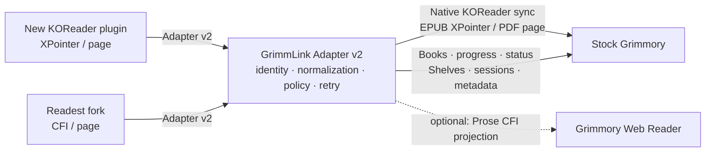

# GrimmLink Adapter v2 — Product & Technical Specification

- **Version:** 1.0.0
- **Status:** Implemented baseline; deployed-build and real-client verification remain open
- **Prepared:** 2026-11-07
- **Target server:** Stock Grimmory, tracking `develop`
- **Clients:** New GrimmLink KOReader plugin and the existing Readest fork

## 1. Executive decision

Build one **GrimmLink Adapter v2** used by both supported clients. Keep the Adapter as the shared integration service; implement the KOReader plugin as a client of it, and update the Grimmory-enabled Readest fork to use the same v2 contract.

Grimmory remains the source of truth for books, shelves, reading status, and server-side reading progress. The Adapter normalizes client differences, applies sync and deletion rules, and calls Grimmory through supported HTTP APIs. It must not write to Grimmory's database.

The new clients are under our control, so v2 does not need to impersonate a KOSync server or preserve the old KOReader plugin's v1 wire contract. The Readest fork remains the supported Readest client because it already has GrimmLink integration and shelf sync. Both clients enter the plain-text KOSync password configured in Grimmory's KOReader settings; the client computes the MD5 auth key. Users never paste an MD5 digest into the password field.



## 2. Goals and scope

### Goals

- Preserve the existing Adapter's good KOReader ↔ Grimmory position round trip.
- Add Readest fork support without making each client reimplement Grimmory API details.
- Sync progress between KOReader and Readest, preserving each reader's native location format.
- Keep Grimmory Web Reader CFI projection as an optional capability; it is not required for v2 readiness.
- Preserve explicit Continue Reading and read-status behavior, including a real first position at the beginning of a book.
- Keep shelf membership add/remove safe across multiple shelves and devices.
- Retain OPF metadata ingestion: read `.opf` or sidecar metadata, resolve the target book safely, and update Grimmory through its supported metadata API. Preserve an OPF cover as a companion sidecar and report it as pending until the documented cover-upload route is implemented and verified against the deployed Grimmory build.
- Provide a local Adapter UI to start and review metadata updates from `.opf` files or sidecars without requiring a command-line workflow.
- Make resource updates safe to retry, durably deduplicate reading sessions, and make unsupported upstream features explicit.

### Out of scope

- Supporting the retired/old KOReader plugin as a v2 compatibility requirement.
- KOSync protocol compatibility for stock Readest.
- Modifying or forking Grimmory server code.
- Direct Grimmory database writes.
- Treating a page percentage as a substitute for an EPUB location.

### Delivery priority

- **Required for v2:** regular shelf listing and membership sync, including add/remove, multi-shelf local ownership safety, and reliable reconciliation after reconnect. This is a primary user workflow and must be complete before v2 is considered ready.
- **Optional for v2:** magic shelf listing and its rule-derived membership. Magic shelves are used less often and may depend on `/api/v1/app/**`; their migration must not block regular shelf sync or the v2 release.
- **Optional for v2:** projection into Grimmory's built-in Web Reader. The required reading workflow is KOReader ↔ Readest; Web Reader CFI projection must not block v2 readiness.

## 3. Grimmory `develop` findings that affect the design

These are source-level observations from Grimmory's public `develop` branch checked on 2026-11-07. Draft pull requests and open issues below are risks, not merged behavior.

| Grimmory behavior | Adapter v2 consequence |
|---|---|
| Native KOReader routes exist at `/api/koreader/users/auth` and `/api/koreader/syncs/progress`; progress is saved to both user/book and file-level progress. | Keep Grimmory's native KOReader route in the KOReader push/pull path so XPointer and device sync semantics remain intact. |
| When a user's KOReader sync is enabled, `KoreaderService.syncProgressToKoreader` may convert an EPUB CFI to XPointer; a failed conversion can leave Book API progress saved while native KOReader position is stale. For PDF/CBX, the helper synchronizes percentage but not the page locator. | Keep Adapter's explicit native progress write and Book API projection results separate. A successful Book API write does not prove the native KOReader locator/page was updated. |
| The `develop` Book API has `GET /api/v1/books/{bookId}`, `POST /api/v1/books/progress`, `POST /api/v1/books/status`, and `POST /api/v1/books/shelves`. Book detail responses are enriched with per-format progress and read status. | Use `GET /books/{bookId}` to read progress/status and `POST /books/progress` to write it; use `/books/status` for explicit status actions. Confirm the DTO against the deployed server OpenAPI. |
| PR [#2812](https://github.com/grimmory-tools/grimmory/pull/2812) is a **Draft** proposing removal of every `/api/v1/app/**` route. The Grimmory maintainer told the user that a progress endpoint already exists, while magic shelf replacement is not ready yet and is expected in a later major release (likely v4). | Replace the Adapter's `/app/books/{id}/progress` calls with Book API read/write routes. Magic shelf is optional and must not block v2. |
| Open issue [#2881](https://github.com/grimmory-tools/grimmory/issues/2881) documents indexed XPointer text-node forms that fail Grimmory's CFI conversion; open issue [#2937](https://github.com/grimmory-tools/grimmory/issues/2937) reports KOReader PDF progress not reaching the Web Reader. | These are Web Reader projection risks only. They do not block native KOReader ↔ Readest position sync. |
| `POST /api/v1/books/progress` derives status from percentage: `>0.1%` starts `READING`, `>=99.5%` marks `READ`; at `<=0.1%` it selects `UNREAD` unless the current status already represents engagement (including `READING`/`READ`). | A real first position that rounds to `0.0%` will not start Continue Reading by itself. After saving verified position data, Adapter must explicitly set `READING` through `/books/status` when needed, while preserving newer manual status. |

### Upstream API contract gate

The replacement is present in current `develop`: `GET /api/v1/books/{bookId}` returns an enriched `Book` DTO; `POST /api/v1/books/progress` accepts `ReadProgressRequest`; `POST /api/v1/books/status` handles explicit status changes. `ReadingProgressService` writes per-file and book-level progress and derives status from progress. The request DTO supports `fileProgress` (`bookFileId`, `positionData`, `positionHref`, `progressPercent`); per-format fields such as `epubProgress`, `pdfProgress`, and `cbxProgress` are still present but marked deprecated. Adapter v2 uses `fileProgress`, and `OfficialGrimmoryClient.update_book_progress` adds the required top-level `bookId` before sending. For Readest writes, the Book API stores CFI/href or page plus percentage. It may also call `syncProgressToKoreader` when a KOReader account is enabled; that helper converts an EPUB CFI to XPointer when possible, but only propagates the percentage for PDF/CBX, not the page locator. Therefore v2 must not treat that helper as proof of full native KOReader position sync. The Adapter explicitly writes the native KOReader position/page when needed. A verified first position at `0.0%` also needs an explicit `/books/status` update to `READING`; Book API progress alone will not set it. Verify these behaviors on the deployed build before release; they do not require waiting for future OPDS progress routes.

Source references on Grimmory `develop`: [`BookController`](https://github.com/grimmory-tools/grimmory/blob/develop/backend/src/main/java/org/booklore/controller/BookController.java), [`ReadProgressRequest`](https://github.com/grimmory-tools/grimmory/blob/develop/backend/src/main/java/org/booklore/model/dto/request/ReadProgressRequest.java), [`BookFileProgress`](https://github.com/grimmory-tools/grimmory/blob/develop/backend/src/main/java/org/booklore/model/dto/request/BookFileProgress.java), [`ReadingProgressService`](https://github.com/grimmory-tools/grimmory/blob/develop/backend/src/main/java/org/booklore/service/progress/ReadingProgressService.java), and [`KoreaderService`](https://github.com/grimmory-tools/grimmory/blob/develop/backend/src/main/java/org/booklore/service/koreader/KoreaderService.java). The API reference is generated from Grimmory 3.5.0 and marked unstable; source-level `develop` behavior and the deployed server's OpenAPI are separate compatibility gates.

## 4. Functional map

| Function | How it works in v2 | Sends to | Result / responsibility |
|---|---|---|---|
| Account linking and client auth | The client user enters the KOSync username and ordinary KOSync password from Grimmory's KOReader settings; the client computes MD5 and authenticates to the Adapter. The Adapter separately links that KOSync identity to the normal Grimmory API account and keeps Official JWT/refresh credentials server-side. | Adapter session auth, Grimmory auth API, and native KOReader auth | One user link joins two credential sets. Readest does not ask users to enter an MD5 value or reuse the normal Grimmory web password in the KOSync field. |
| Book identity | Reuse a validated mapping when available. For a first-seen hash on stock Grimmory, query exact `current_hash` then `initial_hash` through the configured SELECT-only lookup, then verify book/file identity and access through the Book API. Native KOReader progress alone is insufficient because its stock response has no `bookId`. | Adapter identity cache; read-only Grimmory MariaDB identity lookup; `GET /api/v1/books/{bookId}` | Stable, access-checked book/file identity for progress, download, and shelf operations. Without a verified mapping or configured hash lookup, first sync returns an explicit unresolved/unsupported result; it must not guess from a title or shelf listing. |
| Book download | The client supplies both `bookId` and the file `hash`. Resolve the hash for the authenticated user and reject the request unless it maps to that same book ID, then stream the file without changing its bytes. | Adapter identity resolver; Grimmory book download API | KOReader/Readest receives the content whose identity it requested. |
| KOReader progress | Preserve the KOReader XPointer string and fractional progress; use Grimmory's native KOReader push/pull API for native sync. | `PUT/GET /api/koreader/syncs/progress` | KOReader devices round-trip the same native position and device metadata. |
| Readest progress (**required**) | Preserve Readest CFI/href; use the fork's existing CFI↔XPointer helper to exchange positions with KOReader. Keep each reader's native locator; conversions must be tested against the same EPUB fixtures. | Adapter v2; KOReader native route for KOReader locators; supported non-`/app` Book API for Readest persistence/status | Readest resumes by CFI and can receive KOReader position without requiring Grimmory Web Reader. |
| Grimmory Web Reader position (**optional**) | If enabled, use Prose in the Adapter to produce a verified XPointer→CFI projection when it can load the exact EPUB spine document. A failure never blocks native sync. | Supported Book API, only after DTO and non-interference are verified | Best-effort projection; not a v2 release requirement. |
| PDF/CBZ progress (**required**) | Preserve 1-indexed page and total pages when known; store ratio separately as `currentPage / totalPages`. Do not create EPUB CFI. Book API stores Readest page progress; its automatic KOReader side effect currently syncs percentage only. | Supported non-`/app` Book API for Readest persistence, plus Adapter native KOReader write when propagating a page to KOReader | Same page position across KOReader and Readest; optional Web Reader display is separate. |
| Continue Reading / read status | Actual first locator/page can transition `UNREAD → READING` even when rounded display progress is 0%. Near-finished progress may mark `READ`; explicit status has timestamp precedence over stale sync events. | Grimmory progress and status APIs | Grimmory's Continue Reading uses the right status without inventing a percentage. |
| Regular shelf listing and sync (**required**) | Return regular shelves and their paginated membership; reconcile additions/removals without treating a partial response as deletion. | Grimmory regular shelf APIs (`/api/v1/shelves` and supported shelf-book routes) | KOReader and Readest see the same regular shelf membership. |
| Regular shelf membership add/remove (**required**) | Add or unassign a book from a regular shelf. Unassigning never deletes the Grimmory book. | `POST /api/v1/books/shelves` or verified replacement | Membership changes are reflected by both clients and are safe to retry. |
| Magic shelf listing (**optional**) | Return magic shelves as read-only when the target Grimmory build provides a supported route. | Current `/api/v1/app/shelves/magic/**` routes or a verified replacement | If unavailable, advertise this capability as unsupported; it does not block regular shelf sync. |
| Local shelf cleanup | Track client/device ownership by `(bookId, shelfId, shelfType)`. Remove a local file only if it is Adapter-managed and no other synced shelf still owns it. | Adapter ownership state + client local library | Removing one shelf does not remove a book still present in another shelf or manually managed locally. |
| Reading sessions | Submit single/batch sessions with deterministic operation IDs; retries return the prior result. | Grimmory reading-session API when supported | No duplicate sessions after timeout/restart. |
| Ratings, bookmarks, annotations | Map only fields Grimmory exposes through supported HTTP APIs; advertise per-feature capability and return explicit unsupported errors otherwise. | Grimmory rating/notebook/bookmark APIs | No false success for data that cannot be persisted upstream. |
| OPF/sidecar metadata ingestion | **In scope for v2.** Discover and parse `.opf` or supported `.metadata.json` sidecars, normalize supported fields, resolve the exact target book, then update metadata through Grimmory's supported metadata API. Preserve OPF cover art as a companion sidecar; do not claim that a cover was applied until Adapter support and deployed-server verification are complete. | Grimmory metadata API; never direct database writes or book-content replacement | Grimmory's database is updated by Grimmory itself; source OPF and book files remain unchanged. Cover status is explicitly pending until implemented and verified. |
| Local/LAN metadata UI | Open the Adapter page from the same machine or another device on the LAN at `http://grimmlink.local:<configured-port>`, scan configured folders, inspect the matched book and field diff, then explicitly apply the update. | Adapter metadata service and Grimmory metadata API | A visible result per file: updated, skipped, or failed, with a safe reason and no secret values. An unapplied cover is shown as pending/partial. |

### Adapter-to-Grimmory endpoint mapping

The Adapter routes below are the stable client contract. Grimmory routes are implementation details isolated behind the Official API client; upstream changes should normally require an Adapter change only. Network scope is enforced at the reverse proxy: Reader routes are public with Reader authentication, while `/local/**` and the management root are LAN-only. The Compose example binds ports 8085 and 6060 only to the host address configured as `LAN_BIND_IP`, and the host firewall must still restrict them to LAN clients. Never forward either direct port from the Internet, because a direct connection bypasses the proxy's path rules.

The legacy `/api/grimmlink/v1/**` contract remains mounted for existing clients. V2 exposes only the explicit routes listed below (plus the personal metadata and reading-session routes); it does not mirror every v1 alias or Magic Shelf route.

| Adapter route / feature | Grimmory route(s) used by current implementation | Scope | Notes |
|---|---|---|---|
| `POST /auth/session` | `GET /api/koreader/users/auth`; linked normal-account JWT lookup/refresh | Public | Reader sends KOSync username plus MD5 auth key; normal Grimmory password is never sent by reader clients. |
| `POST /local/auth/session` | `POST /api/v1/auth/login`; `GET /api/v1/users/me` | LAN | Management UI login with normal Grimmory username/password. |
| `GET /books/resolve?hash=…` | Reuse a validated Adapter mapping; otherwise exact `current_hash` then `initial_hash` MariaDB `SELECT`, followed by `GET /api/v1/books/{bookId}` to verify access and file identity | Public | Required for unseen hashes on stock Grimmory unless a verified Adapter mapping already exists. Native stock KOReader progress has no `bookId`, so it cannot replace first-time identity lookup. The optional `/api/grimmlink/v1/**` proxy is a fork-only extension, not a stock Grimmory API. `firstSyncHashLookup` reports whether this lookup is configured. |
| `GET /books/{id}/content?hash=…` | Resolve hash to a verified book/file; `GET /api/v1/books/{bookId}/download` | Public | Required hash must resolve to the requested ID before the Adapter streams content to the authenticated reader. |
| `GET /shelves`, `GET /shelves/{id}/items` | `GET /api/v1/shelves`; `GET /api/v1/shelves/{shelfId}/books` | Public | Regular shelves only in v2. |
| `PUT/DELETE /shelves/{id}/items/{bookId}` | `POST /api/v1/books/shelves` | Public | Assignment/unassignment changes shelf membership, never deletes a Grimmory book. |
| `GET /progress/{hash}?reader=koreader` | `GET /api/koreader/syncs/progress/{bookHash}` | Public | Native XPointer/page state is preserved. |
| `GET /progress/{hash}?reader=readest` | `GET /api/v1/books/{bookId}`; optional native `GET /api/koreader/syncs/progress/{bookHash}` | Public | Book DTO provides CFI/page data; native route supplements KOReader locator where available. |
| `PUT /progress/{hash}` | `POST /api/v1/books/progress`; `POST /api/v1/books/status`; `PUT /api/koreader/syncs/progress` as needed | Public | Book API persists Readest locator/page and percentage; explicit status handles first real position at 0%; native route carries KOReader position. |
| `GET/PUT /books/{id}/metadata` | `GET /api/v1/books/{bookId}`; `PUT /api/v1/books/{bookId}/metadata` | LAN | Shared book metadata is a management operation; keep this route LAN-only even though it requires Adapter authentication. Mutations use an operation ID. |
| `POST /reading-sessions[/batch]` | `POST /api/v1/reading-sessions` | Public | Adapter deduplicates operations before forwarding. |
| Metadata automation and OPF apply | `GET /api/v1/libraries`; `GET /api/v1/libraries/{id}`; `GET /api/v1/books/page`; `GET /api/v1/books/{id}`; `PUT /api/v1/books/{id}/metadata` | LAN | Background writes use the operator's encrypted Grimmory refresh credential. The browser can preview before explicit apply. |
| Diagnostics / Setup UI | Health, user, and read-only Adapter identity checks | LAN | Redacted results only; DB setup secret stays in the browser until the operator copies it into server configuration. |

The current Grimmory 3.5.0 API reference documents [progress](https://grimmory.org/api/operations/addbooktoprogress/), [read status](https://grimmory.org/api/operations/updatereadstatus/), [shelf assignment](https://grimmory.org/api/operations/addbooktoshelf/), and [cover upload](https://grimmory.org/api/operations/uploadcoverfromfile/) operations. The cover upload route `POST /api/v1/books/{bookId}/metadata/cover/upload` is **not currently implemented by this Adapter**; add it only after verifying request shape, auth, and persistence on the deployed stock build. The upstream API reference is generated from 3.5.0 and is marked unstable, so the target server's OpenAPI remains the release gate.

## 5. Adapter v2 HTTP contract

### Base and common rules

- Base path: `/api/grimmlink/v2`.
- JSON uses UTF-8; timestamps use ISO-8601 UTC; `fraction` is a number from `0.0` to `1.0`.
- Client login uses the KOSync username and plain-text KOSync password as configured in Grimmory's KOReader settings. The Readest fork computes lowercase MD5 hex automatically and sends it as `x-auth-key`; users must not paste an MD5 digest into the password field.
- `POST /auth/session` accepts `x-auth-user` and `x-auth-key`, validates the KOSync identity, and issues a short-lived Adapter bearer token. Subsequent v2 calls use that token. Never derive the key from the normal Grimmory web/API password.
- The Adapter separately links each KOSync identity to the corresponding normal Grimmory API account. Official JWT/refresh credentials stay server-side; they are never returned to clients or written to logs. Protect stored refresh credentials and any reusable KOSync key as secrets.
- `operationId` is a client correlation ID for progress, book metadata, and local OPF requests; it is echoed in the response but is not a durable request journal. Shelf membership uses idempotent resource operations (`PUT` to assign and `DELETE` to unassign). Reading sessions have durable Adapter-side deduplication. OPF ingestion suppresses a repeat after its successful source fingerprint has been recorded. Do not promise exactly-once execution across an Adapter crash or an upstream timeout unless Grimmory adds an idempotency contract.
- `GET /capabilities` describes supported formats, shelves, status, sessions, metadata, CFI conversion, upstream limitations, whether first-sync hash lookup is configured, and the network scope of metadata features.
- Errors are explicit: `401` invalid client auth, `404` unresolved/unauthorized book, `409` stale/conflicting state, `422` invalid location, and `501` unsupported upstream capability. Do not return success for a queued or skipped write without identifying its state.

### Route set

| Method and route | Purpose |
|---|---|
| `POST /auth/session` | Authenticate the KOSync identity from `x-auth-user` + MD5 `x-auth-key`; return an Adapter token for subsequent v2 requests. |
| `DELETE /auth/session` | Revoke the current Adapter token/device session. |
| `GET /capabilities` | Report negotiated server and client features. |
| `GET /books/resolve?hash={hash}` | Resolve a verified book and primary file. |
| `GET /books/{bookId}/content?hash={hash}` | Verify the hash resolves to this book, then stream the content file. |
| `GET /shelves` | List regular shelves. Magic shelves are not part of the v2 contract. |
| `GET /shelves/{shelfId}/items` | List regular shelf membership with pagination/cursor. |
| `PUT /shelves/{shelfId}/items/{bookId}` | Add a book to a regular shelf; repeat assignment is safe by resource semantics. |
| `DELETE /shelves/{shelfId}/items/{bookId}` | Remove regular shelf membership only; never delete the Grimmory book. Repeating the removal is safe by resource semantics. |
| `GET /progress/{bookHash}?reader={koreader\|readest}` | Return the position projection for the requesting reader. |
| `PUT /progress/{bookHash}` | Upsert normalized position/status and return native-sync and Readest-persistence results; include Web Reader projection only when that optional capability is enabled. |
| `POST /reading-sessions` and `/reading-sessions/batch` | Record idempotent reading sessions. |
| `GET/PUT /books/{bookId}/metadata` | Read/update book metadata and read status fields. `PUT` requires an `operationId` UUID for correlation; the server does not deduplicate by this ID. |
| `GET/POST /syncs/metadata` and `POST /syncs/metadata/batch` | Synchronize supported personal ratings, bookmarks, and annotations through the existing deduplicated metadata service. |
| `GET /local/metadata` | Serve the Adapter's local metadata management UI. |
| `GET /local/diagnostics` | Run authenticated, read-only Adapter/Grimmory/SQLite/identity-DB/mDNS/import-root checks and return a redacted report. |
| `GET /local/metadata/sources` | List supported `.opf` and sidecar files under configured import roots. |
| `POST /local/metadata/preview` | Parse a selected source, resolve candidate Grimmory identity, and return a field diff without writing changes. |
| `POST /local/metadata/apply` | Apply a reviewed preview through Grimmory's supported APIs. Successful repeats are suppressed by the recorded source fingerprint; the request `operationId` is correlation only. |

Adapter session tokens expire after eight hours and are stored in process memory. An Adapter restart revokes existing sessions. Run one worker/replica; multi-worker or multi-replica deployment requires a shared session store first.

The Localhost/LAN management UI signs in with the ordinary Grimmory web account through `POST /local/auth/session`. Its Adapter session keeps the Official access/refresh credentials in memory. The operator explicitly connects the background metadata account, which stores its refresh credential encrypted. Reader sessions still use KOSync credentials supplied by Readest or KOReader to `POST /auth/session`; the management UI never asks for KOSync credentials.

### Setup and diagnostics UI

- The Setup page generates a copyable `.env` snippet for `GRIMMORY_DB_*` in browser memory only. It never submits or stores the database password. The operator pastes it into the Adapter's private environment file and restarts the process.
- The authenticated Diagnostics view checks the Grimmory health endpoint, read-only Adapter SQLite integrity, exact SELECT access for the Grimmory identity query, configured metadata roots, and live mDNS registration. It displays a specific next action for failed checks.
- Downloaded diagnostic JSON omits passwords, MD5 keys, bearer tokens, and raw connection error messages. It may include local file paths needed to diagnose permissions; review the report before sharing it.
- Run the same system checks from a terminal with `uv run python -m grimmlink_adapter.diagnostics`.

The route names above define the proposed v2 contract. The Official Grimmory URLs remain behind the Adapter's Official API client so a future upstream API change does not require another client protocol change. The request `operationId` on progress and metadata updates is for tracing/correlation; those endpoints do not persist and replay a response by operation ID. Clients should retry state-setting operations with the same payload and timestamp, and use `expectedUpdatedAt` to detect stale progress. Reading-session deduplication is durable and separate.

### Progress payload

```json
{
  "operationId": "uuid",
  "source": "koreader",
  "device": { "id": "device-id", "name": "KOReader" },
  "updatedAt": "2026-11-06T00:00:00Z",
  "fraction": 0.202,
  "position": {
    "format": "epub",
    "xpointer": "/body/DocFragment[12]/body/p/text().42",
    "cfi": null,
    "href": "OEBPS/Text/chapter-12.xhtml"
  }
}
```

`position` is format-specific:

- **EPUB:** retain the source reader's native locator (`xpointer` for KOReader; `cfi`/`href` for Readest). A converted locator is additional data, never a replacement for the source locator.
- **PDF/CBZ:** `page` is 1-indexed; `totalPages` is optional. Preserve a native page position even when total page count is unknown.
- The Adapter does not infer position from `fraction`. `fraction` is for status/display and must remain the same ratio end-to-end; for example, `55 / 16653 ≈ 0.0033` means about `0.33%`.

Progress response separates the writes:

```json
{
  "nativeSync": { "status": "synced", "reader": "koreader" },
  "readestProjection": { "status": "synced", "locator": "cfi" },
  "readStatus": { "value": "READING", "source": "position" }
}
```

Allowed projection states are `synced`, `skipped`, `failed`, and `unsupported`. Native KOReader success must not imply Readest or optional Web Reader projection success.

## 6. Progress, CFI, and Prose integration

### Position ownership

The v2 model stores each reader's native location and any verified conversions. KOReader XPointer remains the native value used for KOReader round trips. Readest CFI/href remains the native value used by Readest and the Grimmory EPUB reader. The Adapter must preserve the original string and avoid lossy normalization.

For Readest, first reuse the fork's existing `utils/xcfi.ts` conversion at the point where Readest has the loaded EPUB document. Evaluate `@prose-reader/koreader` as a replacement/helper only after the same EPUB fixtures prove parity for existing positions.

The required cross-reader path is KOReader ↔ Readest. The Adapter preserves the native KOReader XPointer; Readest uses its existing CFI↔XPointer helper when the EPUB document is open. Grimmory Web Reader projection is optional because it is not part of the user's required reading workflow. If enabled later, add a separate Adapter-owned step using the [Prose KOReader package](https://doc.prose-reader.com/koreader) to convert XPointer→CFI when the Adapter can load the matching EPUB spine-item `Document`. Prose is a conversion library, not a sync client or network integration; it requires verified book identity, read-only access to the EPUB, OPF/spine resolution, and a DOM matching the source location. Grimmory's built-in conversion can remain enabled, but it is not the sole reliable projection path because some accepted XPointer forms fail conversion upstream.

If Grimmory Web Reader projection is enabled, implement Prose conversion behind an Adapter converter worker (or equivalent), with bounded EPUB size/time, strict path validation, and fixture coverage. It is required before that optional capability is advertised; it is not a prerequisite for v2 or native KOReader ↔ Readest sync. On missing/ambiguous DOM, unsupported indexed pointer, or conversion failure:

1. Keep the native XPointer/page push and pull working.
2. Keep the last known-good CFI; never replace it with an unverified chapter-start or guessed location.
3. Return `webReaderProjection.status = failed|skipped` with a safe reason; keep native sync marked successful if it succeeded.
4. Do not claim exact Web Reader synchronization until a real Grimmory Reader open/resume check passes.

Prose conversion is EPUB-only. PDF/CBZ use page locations. Prose documentation also notes that CFI resolution may differ when book CSS affects the DOM and that some legacy pointers may parse without resolving; these cases belong in acceptance fixtures.

## 7. Continue Reading and status policy

1. A non-empty, verified location/page is evidence of reading even when `fraction` rounds to zero. Grimmory's Book API uses percentage thresholds and does not infer reading from a non-empty locator; if the current status is `UNREAD`, Adapter must follow the progress write with an explicit `POST /api/v1/books/status` to set `READING`.
2. `fraction >= 0.995` may mark `READ`; a client may also explicitly mark the book read.
3. A low fraction alone must not mark a book `UNREAD`. An explicit user status operation is required to set `UNREAD`.
4. Explicit status has precedence over older queued progress. Compare event timestamps/sequence values before applying automatic transitions.
5. A new, later reading position can reopen a completed book to `READING`; it must not be blocked by an older manual `READ` event.
6. Keep display percentage separate from status and position. Never fake `1%`, `10%`, or a page location to force Continue Reading.

The Official Book progress endpoint currently derives status from percentage thresholds (`>0.1%` for `READING`, `>=99.5%` for `READ`), while preserving an already engaged status when progress is at or below `0.1%`. The Adapter must still apply its first-position policy through the explicit Official status endpoint when a verified location exists but the percentage rounds to zero. It must then read back status and protect newer manual status from stale sync events. This behavior is a contract test requirement.

## 8. Local and LAN metadata management UI

The [OPF/sidecar automation workflow](OPF_SIDECAR_AUTOMATION_DESIGN.md) now has a worktree implementation for library discovery, source-change detection, a durable queue, per-field conflict handling, and encrypted server-side account binding. Auto is a separate per-library setting; Manual runs remain available while Auto is enabled. The per-file scan/preview/apply flow below remains available. Deployed Pi4/NAS integration is still unverified.

The Adapter includes a small web UI for the existing OPF/sidecar ingestion workflow. It is an operator interface to the same metadata service used by the Adapter, not a second metadata implementation. It must work both on the Adapter host and from other devices on the same LAN.

### LAN address and discovery

- Advertise the Adapter UI through mDNS as `grimmlink.local`; use the Adapter's configured HTTP port, so the direct LAN URL is `http://grimmlink.local:<configured-port>`. In the Compose example, bind this port to `LAN_BIND_IP` and restrict it to LAN clients at the host firewall. For public Reader access, expose the reverse proxy and route only authenticated Reader endpoints publicly; its `/local/**` and root paths must remain LAN-only.
- The listener must be configurable for LAN access (for example, bind to the host's LAN interface or `0.0.0.0`). Loopback-only binding is not sufficient for the requested workflow.
- mDNS advertisement must be implemented at the host/container deployment layer that can receive and send multicast on the LAN. Document any required host networking or mDNS reflector settings for Docker deployments.
- If the LAN blocks multicast or `.local` resolution, show the configured LAN IP/port as a fallback; the UI remains available by direct address.
- Allow the hostname and port to be configured to avoid collisions with another device already advertising `grimmlink.local`.

### Operator flow

1. The operator chooses a configured import root and scans for adjacent `.opf`, `.metadata.json`, and supported cover sidecars such as `.cover.jpg`.
2. The UI shows source path, detected format, parse status, and possible Grimmory book matches. Matching uses verified hash/file identity when available; title/author similarity may suggest candidates but cannot silently select the target.
3. The operator selects the target book and reviews a before/after field diff, including whether cover art will remain pending and fields that would be skipped due to locks or unsupported upstream fields.
4. The operator explicitly applies the preview. The Adapter writes metadata through Grimmory's supported API, preserves cover art as a companion sidecar, and records the per-file result.
5. A successful repeat with an unchanged source fingerprint is suppressed. The `operationId` is for correlation; an upstream timeout/crash does not have an exactly-once guarantee.

### UI and file safety

- Require authentication for management data and actions from both localhost and LAN; the static login shell may load before authentication. Do not treat being on the local network as identity. Keep the listener private to the host/LAN by default and do not expose it through a public interface unless explicitly configured.
- Protect state-changing preview/apply actions against cross-site requests, and do not put credentials or tokens in page URLs, mDNS records, or browser-visible logs.
- The UI can read only configured import roots. Reject traversal, symlink escapes, unsupported extensions, oversized files, and paths outside those roots.
- Preview is read-only. Apply is an explicit operator action; scanning a folder must never update Grimmory automatically.
- Never edit or rewrite the source `.opf`, sidecar, cover, or ebook. Metadata updates change Grimmory's records only through its HTTP APIs.
- Ambiguous identity, malformed input, authentication/authorization failures, and field-lock conflicts must stop the update; sidecar fallback must not hide these errors.
- Show partial success clearly when metadata updates but cover art cannot be uploaded. Do not route cover data through the book-content replacement API. Keep safe audit data (source path relative to configured root, matched book ID, changed field names, outcome, timestamp); never log credentials, tokens, or full book contents.

## 9. Shelf deletion and ownership rules

- A shelf removal means **unassign this book from this shelf**. It never deletes the Grimmory book or ebook file.
- Magic shelves are read-only because their membership is rule-derived. Their availability is optional and must not block regular shelf operations.
- Local removal is allowed only for Adapter-managed downloads. Keep the file if another synced shelf still owns it, if the user added it manually, or if ownership is unknown.
- Record membership ownership by client/device, book, shelf, and shelf type. Reconcile from an authoritative shelf snapshot/cursor after reconnect; do not treat a partial page as deletion.
- If a target Grimmory version drops `/api/v1/app/shelves/magic` and has no verified replacement, advertise magic shelf sync as unsupported on that server version; never return an empty list as if there were no magic shelves.

## 10. Migration from the current Adapter and Readest fork

| Area | Keep | Change for v2 |
|---|---|---|
| KOReader progress | Native XPointer, fraction, PDF page handling, verified-hash resolution, minimal identity response, and cross-device round trip. | New plugin calls v2. Adapter maps v2 to Grimmory native KOReader API; optional Web Reader projection is separately gated. |
| Continue Reading | First-real-position handling and manual-status timestamp guard. | Make the rule explicit across both clients and verify after upstream native status updates. |
| Shelves | Regular shelf sync, safe unassignment, magic-shelf read-only behavior, and multi-shelf local ownership. | Move clients to one versioned v2 contract; gate magic shelf support on the actual Grimmory version/API capability. |
| Readest | Existing fork's GrimmLink progress and shelf sync. | Update fork to v2, retain its reader-native CFI/href and existing conversion utility during parity work. |
| Authentication | KOSync username/password field semantics (plain password entered, MD5 computed by client), Adapter-side Grimmory token handling, and secret redaction. | Preserve the KOSync credential form for Readest and the new KOReader plugin; link those credentials to the normal Grimmory API account server-side. |
| Sessions/metadata | Idempotency, rating conversion, and current supported sync mappings. | Capability-gate each upstream feature and return explicit unsupported/error states. |
| OPF/sidecar ingestion | Existing parser/normalizer workflow, metadata mapping, identity checks, sidecar fallback rules, and file safety invariants. | Keep as a first-class Adapter v2 capability, separate from reader progress endpoints; write metadata through the supported Official API and clearly report cover art as pending until the documented cover-upload route is implemented and verified. |

No data migration is required for the Adapter's derived caches if they remain rebuildable. Preserve pending outbox operations and ownership state during rollout. Deploy the Adapter v2 routes before updating either client; then update Readest fork and the new KOReader plugin independently. Keep v1 routes only for operational rollback if convenient, but v1 compatibility is not a v2 acceptance requirement.

## 11. Acceptance criteria

- KOReader device A → Adapter → Grimmory → KOReader device B receives the exact same native XPointer and fractional progress.
- Readest fork sends CFI/href and resumes at the same location after a fresh app launch; its shelf sync still works.
- Readest ↔ KOReader position conversion is checked on real EPUB fixtures, including nested elements and duplicate text.
- KOReader XPointer is preserved exactly by the Adapter; Readest receives it and converts it to CFI through the fork's tested helper.
- PDF page position round-trips between KOReader and Readest without requiring EPUB CFI or Grimmory Web Reader projection.
- First position at the start of an EPUB/PDF appears as `READING`/Continue Reading without percentage inflation.
- Explicit `READ`, `UNREAD`, and resume transitions behave according to timestamp precedence.
- Removing one shelf membership never deletes the Grimmory book and never removes a local copy still owned by another shelf.
- Regular shelf listing, add/remove, reconnect reconciliation, and multi-shelf file ownership all work without relying on `/api/v1/app/**`.
- Magic shelf removal is rejected; a missing upstream magic-shelf API is shown as unsupported, not as an empty shelf, and does not block v2 readiness.
- Retried progress, shelf, and session mutations do not duplicate effects.
- No operation reports success when upstream rejected it, a projection was skipped, or a capability is unsupported.
- Local UI scan and preview do not mutate Grimmory; explicit apply updates the selected book through Official APIs.
- The UI rejects ambiguous book matches and paths outside configured roots, and reports metadata/cover partial failures accurately.
- The Setup form creates a copyable DB environment snippet locally in the browser; it does not submit or persist the DB password.
- UI and CLI diagnostics verify the same read-only checks, provide actionable failure messages, and omit credentials and tokens from exported reports.
- A second device on the LAN can resolve `grimmlink.local` through mDNS and load the authenticated UI; direct LAN IP/port works as the fallback when multicast is unavailable.

## 12. Open implementation gates

1. Capture the target Grimmory build's OpenAPI schema and verify progress/status writes, shelf assignment, file download, sessions, notebook/rating routes, OPF metadata DTO, and the documented cover-upload route. Cover application remains pending until the Adapter implementation and deployed-build persistence are verified.
2. Verify whether the configured KOReader sync + `syncWithWebReader` settings cause `POST /api/v1/books/progress` to update native KOReader state. The current helper converts EPUB CFI to XPointer but only copies percentage for PDF/CBZ; define and verify explicit native writes from Adapter for any missing locator/page propagation.
3. Verify regular shelf list/items and add/remove against the target Grimmory build. Magic shelf API replacement is a v4 follow-up and is not a v2 gate.
4. If Grimmory Web Reader projection is enabled, implement the Prose converter worker with a matching-EPUB DOM and tested spine resolution; native KOReader ↔ Readest sync remains independent of it.
5. Verify status precedence against the exact current Grimmory build; native KOReader sync may apply automatic status before Adapter correction.
6. Confirm whether v1 routes remain temporarily enabled for rollback; this is operational only, not a v2 client requirement.

## References

- Grimmory [`KoreaderController`](https://github.com/grimmory-tools/grimmory/blob/develop/backend/src/main/java/org/booklore/controller/KoreaderController.java)
- Grimmory [`KoreaderService`](https://github.com/grimmory-tools/grimmory/blob/develop/backend/src/main/java/org/booklore/service/koreader/KoreaderService.java)
- Grimmory [`BookController`](https://github.com/grimmory-tools/grimmory/blob/develop/backend/src/main/java/org/booklore/controller/BookController.java)
- Grimmory [`ReadingProgressService`](https://github.com/grimmory-tools/grimmory/blob/develop/backend/src/main/java/org/booklore/service/progress/ReadingProgressService.java)
- Grimmory draft [#2812: drop `/app/` API endpoints](https://github.com/grimmory-tools/grimmory/pull/2812)
- Grimmory open [#2881: indexed XPointer is not converted to CFI](https://github.com/grimmory-tools/grimmory/issues/2881)
- Grimmory open [#2937: PDF KOReader progress not synced to Web Reader](https://github.com/grimmory-tools/grimmory/issues/2937)
- [Prose KOReader conversion docs](https://doc.prose-reader.com/koreader)
- Historical pre-v2 context: [`ARCHITECTURE.md`](./ARCHITECTURE.md), [`PROGRESS_SYNC_STATUS.md`](./PROGRESS_SYNC_STATUS.md), [`MIGRATION_PLAN.md`](./MIGRATION_PLAN.md), and [`Official API parity audit`](../references/OFFICIAL_GRIMMORY_API_PARITY_AUDIT.md)
