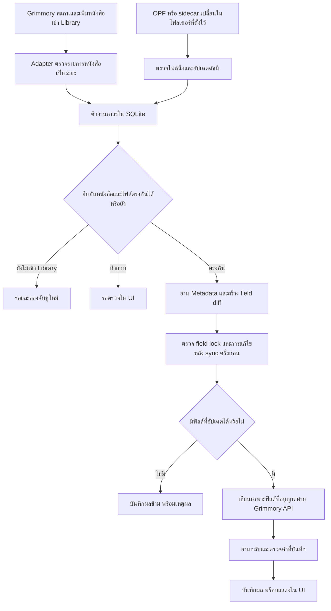

# OPF / Sidecar automation — แบบเสนอสำหรับ GrimmLink V2

วันที่: 2026-11-07

สถานะ: **เพิ่ม implementation หลักใน worktree แล้ว; ยังไม่ deploy หรือทดสอบกับ Pi4/NAS/Grimmory จริง**

สิ่งที่ทำแล้ว: per-library policies, NAS root/marker mapping, Auto + Manual runs, SQLite queue พร้อมกู้หลัง restart, คิวสลับ Library ทุก 20 เล่ม, per-field conflict/lock policy, readback/intent recovery, encrypted account binding, activity และ diagnostics ใน UI

ขอบเขต implementation ปัจจุบัน: source discovery ทำร่วมกับแต่ละรอบ poll แทน watcher แยก; ตรวจค่าฝั่ง Grimmory ซ้ำอย่างน้อยทุก 30 นาทีสำหรับ source ที่ไม่เปลี่ยน; source ที่เพิ่งพบรอให้ไฟล์นิ่งก่อนเริ่ม; Auto ใช้ API-only และปกยัง pending; output-sidecar delivery และ event-trigger จาก upstream เป็นส่วนขยายที่ยังไม่ได้เปิดใช้ รายละเอียดด้านล่างบอกทั้งกติกาหลักและส่วนขยายดังกล่าว

ก่อนงานนี้มี parser, hash identity lookup, metadata API client, ingestion state และหน้า manual preview/apply อยู่แล้ว งาน Auto และ Manual run ใช้ parser, การยืนยันตัวตนของไฟล์, การตรวจ settings และ API เดิม ร่วมกับตัววางแผนและคิวที่เพิ่มในรอบนี้ ส่วน manual รายไฟล์เดิมใช้ตัวกันเขียนพร้อมกันร่วมกับ worker

## โครงสร้างเครื่องของผู้ใช้

ข้อมูลที่ยืนยันจากผู้ใช้: ไฟล์หนังสือและ OPF อยู่บน NAS ซึ่ง mount เข้า Raspberry Pi 4 ที่รัน Grimmory server

ข้อเสนอการติดตั้ง: รัน Adapter บน Pi4 เครื่องเดียวกัน ให้ทั้ง Grimmory และ Adapter อ่านไฟล์จาก NAS mount เดียวกัน ไม่ต้องคัดลอกหนังสือไปไว้บนเครื่องที่เปิด UI ทั้งนี้ยังไม่ได้ยืนยันว่า Adapter ถูกติดตั้งบน Pi4 แล้ว

```text
NAS: หนังสือ + OPF / supported sidecar
              │ SMB/NFS mount ที่ใช้อยู่
              ▼
Pi4: NAS mount บน host
      ├── Grimmory → scan และจัดการ Library
      └── Adapter  → อ่าน source + อัปเดต Grimmory ผ่าน API
                            ▲
                       UI ผ่านวง LAN
                    คอมพิวเตอร์ / มือถือ
```

- หากใช้ Docker ให้ bind mount โฟลเดอร์ NAS บน Pi4 เข้า container ทั้งสอง ตัวอย่างสมมติ: host `/mnt/nas/books`, Grimmory `/books`, Adapter `/library` เส้นทางจริงยังต้องระบุจากเครื่อง Pi4
- Mapping จึงอาจเป็น Grimmory Library path `/books/novels` ↔ Adapter root `/library/novels` แม้ path ใน container ต่างกัน แต่ต้องชี้ไฟล์ชุดเดียวกัน
- `METADATA_IMPORT_ROOTS` ใช้ path ที่ Adapter มองเห็น ไม่ใช่ Windows path ของเครื่องที่เปิด UI หรือ NAS share URL
- Auto/API metadata mode ควรเริ่มจาก mount หนังสือแบบ read-only ใน Adapter; เก็บ SQLite, queue, account binding และ logs บน local persistent volume ของ Pi4
- Output sidecar เป็นตัวเลือกที่ต้องมี write permission บนโฟลเดอร์ NAS; การอ่าน OPF/JSON เป็น input ไม่ต้องเปิดสิทธิ์เขียน NAS หากต้องการให้ Grimmory import output ต้องยืนยันว่า Grimmory อ่านไฟล์ที่สร้างจาก mount เดียวกันได้
- สำหรับ NAS ใช้ polling/reconciliation เป็นฐาน ไม่พึ่ง filesystem watcher อย่างเดียว เพราะการแก้ไฟล์จากเครื่องอื่นอาจไม่มี event มาถึง Pi4
- ก่อน discovery ตรวจความพร้อมของ mount และ marker ที่กำหนดไว้ หาก NAS หลุดหรือเหลือเพียง mount-point เปล่า ให้ pause งานที่เกี่ยวข้องและแจ้ง `storage_unavailable` ไม่สรุปว่าหนังสือ/source ถูกลบ และไม่สร้าง output ลง mount-point ที่ไม่มี NAS
- เมื่อ NAS กลับมา ให้ตรวจไฟล์นิ่งและ reconcile ใหม่ แล้วทำคิวต่อ
- บน Pi4 เริ่มหนึ่ง worker, แบ่งรอบตรวจแต่ละ Library, cache file fingerprints และไม่อ่านไฟล์หนังสือทั้งคลังซ้ำทุกรอบโดยไม่มีเหตุ ตรวจ fingerprints ที่จำเป็นอีกครั้งก่อนเขียน
- ชื่อ mDNS ของ UI ชี้ไปยัง Pi4 ที่รัน Adapter; ไม่ใช่ hostname ของ NAS

## 1. พฤติกรรมหลัก

หลังเปิด Auto metadata สำหรับ Library ที่เลือก Grimmory เป็นผู้เพิ่มหนังสือเข้า Library ก่อน จากนั้น Adapter จึงจับคู่กับไฟล์จริง อ่าน OPF หรือ JSON sidecar และอัปเดต Metadata ผ่าน Grimmory API โดยไม่ต้องเปิดหน้า UI ค้างไว้

Library เป็นแหล่งอ้างอิงว่าหนังสือเล่มใดมีอยู่และบัญชีเข้าถึงได้ ไฟล์ OPF/sidecar เป็นแหล่งข้อมูลที่จะนำเข้า Adapter ไม่เพิ่มหนังสือเข้า Grimmory เองใน workflow นี้

การอ่านฐานข้อมูล Grimmory ใช้ SELECT เพื่อช่วยยืนยัน identity เท่านั้น การแก้ Metadata ส่งผ่าน HTTP API เสมอ



## 2. ตรวจการเปลี่ยนแปลงจากสองฝั่ง

| ตัวตรวจ | หน้าที่ | ค่าเริ่มต้นที่เสนอ |
|---|---|---|
| Library poller | อ่านหนังสือใน Library ที่เปิด Auto เป็นหน้า ตรวจ book/file ใหม่หรือเปลี่ยน | ค่าเริ่มต้น 300 วินาทีสำหรับ Library ใหม่ |
| Source indexer | หา OPF/JSON ที่เพิ่ม เปลี่ยน ย้าย หรือลบ รวมถึงของหนังสือเดิม | ตรวจ stat ทุก 60 วินาที; watcher เป็นตัวช่วยเร่งได้ |
| Reconciliation | ไล่รายการและไฟล์ซ้ำแบบแบ่งงาน เพื่อกู้รายการที่พลาดและตรวจความสอดคล้อง | ทุก 30 นาที ปรับได้ตามขนาดคลัง |
| Manual controls | สั่งตรวจทันที, ทำย้อนหลัง, retry หรือ pause | ใช้ queue และ policy เดียวกับ Auto |

- รายละเอียด Books API pagination/filter และ metadata write ต้องยืนยันกับ build เป้าหมายก่อน implement; ไม่ผูก scheduler กับ API `/app/` หรือ event ที่ยังไม่ได้ตรวจสอบว่ารองรับ
- ไม่ถือว่า timestamp หรือ ID สูงสุดเพียงอย่างเดียวพิสูจน์ว่าตรวจครบ ใช้ pagination ที่ตรวจความครบได้ และ reconcile ซ้ำพร้อม dedupe
- ถ้ารอบอ่าน API ล้มเหลวหรือได้ข้อมูลไม่ครบ ห้ามสรุปว่าหนังสือที่หายไปถูกลบ
- เริ่มใช้ polling ได้โดยไม่ต้อง fork Grimmory หากมี event ที่รองรับในอนาคต ใช้เป็นสัญญาณเร่งแล้ว reconcile ผ่าน API อีกครั้ง
- หลังพบไฟล์เปลี่ยน รออย่างน้อย 30 วินาทีและตรวจ size/mtime นิ่งสองครั้งก่อนอ่าน จากนั้น fingerprint ก่อน/หลังอ่านต้องตรงกัน
- งานที่ยังจับคู่กับ Library ไม่ได้อยู่สถานะรอ มี backoff; หลังรอนานให้แจ้งใน UI และตรวจซ้ำใน reconciliation ไม่หายจากคิวเงียบ ๆ
- ถ้าไม่มี Metadata source ให้บันทึก `no_source` การพบไฟล์ใหม่ภายหลังจะปลุกงานอีกครั้ง

## 3. ระบุหนังสือและ source อย่างไร

1. ผู้ใช้เลือก Library และตั้ง mapping ระหว่าง Library path ของ Grimmory กับโฟลเดอร์ที่ Adapter มองเห็น เช่น Grimmory `/books/novels` และ Adapter `/library/novels`
2. API book/file identity และ local file fingerprint ต้องสอดคล้องกัน อาศัย SELECT hash lookup ที่มีอยู่ได้ แต่ต้องตรวจสิทธิ์ผ่าน API ด้วยบัญชีที่ผูกงานนั้น
3. ไม่เลือกเป้าหมายจากชื่อหนังสือหรือชื่อไฟล์เพียงอย่างเดียว ถ้า hash ซ้ำหลายเล่ม ต้องใช้ Library/path/file ID ประกอบจนเหลือหนึ่งเป้าหมาย มิฉะนั้น `needs_review`
4. หา source อยู่ข้างไฟล์หนังสือ โดยเสนอชื่อเจาะจงเล่มก่อน เช่น `Novel.opf` หรือ `Novel.metadata.json`; `metadata.opf` ใช้อัตโนมัติได้เมื่อโฟลเดอร์มีเป้าหมายชัดเจน
5. หากมี OPF และ JSON ที่ให้ค่าต่างกัน ไม่มีการเลือกตามเวลาที่แก้ล่าสุดเอง ผู้ใช้ตั้ง source preference ต่อ Library หรือเลือก source รายเล่มใน UI
6. ถ้ามีหลาย source แต่ค่าที่ normalize แล้วเหมือนกัน เลือกตามลำดับที่กำหนดและเก็บ provenance ไว้
7. Metadata ใน Grimmory อยู่ระดับหนังสือ หากหลาย format ของเล่มเดียวกันมี source ต่างกัน ให้มี source หลักเพียงหนึ่งชุด; ข้อมูลขัดกันต้องตรวจ ห้ามให้ EPUB/PDF ผลัดกันเขียน
8. จำกัด roots, ขนาดไฟล์, traversal/symlink และ parser เช่นเดียวกับ manual workflow

การย้าย/เปลี่ยนชื่อ source ใช้ fingerprint และ verified book/file identity เชื่อมประวัติเดิม ไม่ถือว่าเป็นหนังสือใหม่เพียงเพราะ path เปลี่ยน

## 4. กติกาว่าฟิลด์ไหนเขียนได้

นโยบายแนะนำ: **ข้อมูลที่มีค่าจาก source ใช้กับหนังสือใหม่โดยอัตโนมัติ และรักษาการแก้ไขใน Grimmory ภายหลัง**

| กรณี | ผลที่ต้องการ |
|---|---|
| หนังสือใหม่ มี source ชัดเจน | ใช้ค่าที่ source ระบุแทนค่าที่ Grimmory สแกนมา เฉพาะฟิลด์ที่เปิด sync และไม่ล็อก |
| Source ไม่ระบุฟิลด์หรือส่งค่าว่าง | ไม่ล้างค่าใน Grimmory; การล้างต้องเป็นคำสั่ง explicit ใน UI |
| Source เปลี่ยน และ Grimmory ยังมีค่าเท่ากับที่ Adapter เคยบันทึก | อัปเดตอัตโนมัติได้ |
| Grimmory เปลี่ยนจากค่าที่เคยบันทึก เช่น มีคนแก้หรือ metadata provider อัปเดต | ถ้าค่า source ต่างจากค่าปัจจุบัน ให้ field นั้น `conflict` และรอตรวจ |
| Source และ Grimmory ตรงกันอยู่แล้ว | ไม่ต้องเขียน บันทึกว่า in sync |
| ฟิลด์ถูกล็อก | ข้ามฟิลด์นั้น แสดงเหตุผล; ฟิลด์อื่นที่ปลอดภัยยังทำต่อได้ |
| ทุกฟิลด์ถูกล็อก | ข้ามพร้อมเหตุผล ไม่ fallback เพื่อฝ่าล็อก |
| หนังสือมีอยู่ก่อนเปิด Auto | แสดงจำนวนย้อนหลัง ให้ผู้ใช้เริ่ม Backfill โดยเลือก “เติมเฉพาะช่องว่าง” หรือ “ใช้ source ในฟิลด์ที่เลือก” |

เทียบสามค่าเป็นรายฟิลด์: source ปัจจุบัน, Grimmory ปัจจุบัน และ baseline หลังบันทึกสำเร็จครั้งก่อน ไม่ถือว่าการเปลี่ยนใน Grimmory ต้องมาจากคนเสมอไป

ในงาน metadata นี้ไม่เขียน reading status, progress, Continue Reading, Shelf membership, personal rating, bookmarks หรือ annotations

ข้อแตกต่างจาก service ปัจจุบัน: ต้องคำนวณเฉพาะฟิลด์ที่เปลี่ยนจริง ปัจจุบัน preview รวมฟิลด์ที่ source ส่งมาทั้งหมด และการพบ locked field อาจหยุดทั้งงาน ต้องเพิ่ม field planning และ payload ที่ไม่เปลี่ยนฟิลด์อื่น รวมถึงยืนยัน merge/replace behavior ของ upstream

## 5. เขียน API และตรวจผล

1. สร้างแผนการเขียนที่มี source fingerprints, target identity, before values, allowed field diff และ policy revision
2. ก่อนส่ง ตรวจ source และ target อีกครั้ง; ถ้ามีการเปลี่ยนให้ยกเลิกแผนเก่าและคำนวณใหม่
3. ตรวจการตั้งค่าของ Grimmory ที่อาจเขียน Metadata กลับไฟล์หรือย้ายไฟล์ ถ้าตรวจไม่ได้หรือยังเปิดอยู่ ให้ `blocked_configuration`; UI แสดงค่าที่ต้องแก้ ไม่อ้างว่าฐานข้อมูลอัปเดตแล้ว
4. ส่งเฉพาะฟิลด์ที่อนุญาตผ่าน metadata API ไม่ใช้การเขียน DB โดยตรง
5. อ่านกลับและเทียบค่าหลัง normalize ตาม API contract ถ้าบางฟิลด์ยังไม่ตรงเป็น `partial` พร้อมบันทึกแยกฟิลด์
6. ตรวจ fingerprint หนังสือและ source หลังทำงาน เพื่อพบการเปลี่ยนไฟล์ที่ไม่คาดคิด หยุดและแจ้งเหตุเมื่อผิดเงื่อนไข; การตรวจพบไม่ได้เป็นการ rollback API write ที่สำเร็จไปแล้ว
7. อัปเดต baseline เฉพาะฟิลด์ที่ยืนยันสำเร็จ จึงสรุป `updated`

ก่อนเขียนมีความเสี่ยงที่ผู้ใช้จะแก้พร้อมกัน หาก upstream ไม่รองรับ conditional update/ETag จะยังปิด race นี้ไม่ได้ทั้งหมด ต้องอ่านก่อนเขียนทันที เขียนให้น้อยที่สุด และอ่านกลับ ไม่มีการอ้างว่าเป็น atomic compare-and-swap

## 6. ความหมายของ sidecar และรูปปก

แยกสองบทบาทให้ชัด:

| บทบาท | การทำงาน |
|---|---|
| OPF / `.metadata.json` ที่ผู้ใช้เตรียม | เป็น input source ของ Auto ใช้ parser ที่รองรับ ไม่สมมติว่า JSON ทุกเครื่องมือมี schema เดียวกัน |
| Sidecar ที่ Adapter สร้าง | เป็น output/fallback ที่เลือกเปิดเพิ่มได้ ไม่ถูกนำมาเป็น input เพื่อทำงานวนซ้ำ |

- เส้นทาง Auto ปกติใช้ API สำหรับ Metadata ถ้า API ไม่พร้อมให้ queue retry หรือแสดง blocked ก่อน ไม่สร้าง sidecar ซ้ำทุกครั้งโดยอัตโนมัติ
- Sidecar delivery เปิดต่อ Library ได้เมื่อผู้ใช้ต้องการ และต้องยืนยันรูปแบบ/ชื่อไฟล์ที่ upstream importer รองรับ รวมถึงโฟลเดอร์ที่ทั้งสอง container มองเห็น
- ถ้าสร้าง sidecar แล้วแต่ import ไม่ได้ ให้ `pending_import`; ต้องแยกจาก `updated`
- ห้ามเขียนทับ input source หรือไฟล์ของเครื่องมืออื่น หากชื่อ output ชนให้หยุดและแสดง conflict
- การอัปเดต Metadata ผ่าน API แล้วสำเร็จต้องไม่ถูกทำซ้ำเพียงเพราะปกยัง pending เก็บ metadata result และ cover result แยกกัน
- ตามขีดจำกัดของ implementation ที่มีอยู่ ปกยังเป็น `cover_pending` เมื่อไม่มีช่องทางที่ยืนยันว่าปลอดภัยกับไฟล์ต้นฉบับ การเก็บภาพไว้เป็น sidecar ไม่เท่ากับเปลี่ยนปกใน Grimmory แล้ว
- การลบ OPF/sidecar ไม่ล้าง Metadata ใน Grimmory และไม่ลบหนังสือ

## 7. Queue, บัญชี และการกู้หลัง restart

Job มี state หลัก: `queued → waiting_stable → resolving → planning → applying → verifying → updated / in_sync / skipped / partial / needs_review / retry_wait / blocked` พร้อม reason code

- Queue, source index, policy, field baseline, attempt และผลลัพธ์เก็บใน SQLite
- กุญแจกันงานซ้ำใช้ server identity + Library + book ID + file ID + source revision + policy revision; path เป็น locator ที่เปลี่ยนได้
- มี lock/lease ต่อ book เพื่อไม่ให้หลาย format, manual apply และ Auto เขียนพร้อมกัน; lease หมดอายุแล้วกู้ได้
- งานค้างใน `applying` หรือ `verifying` หลัง restart ต้องอ่านผลจาก Grimmory ก่อน retry เพราะคำขอก่อนหน้าอาจสำเร็จแล้ว
- Timeout/5xx ใช้ exponential backoff พร้อม jitter เช่น 1, 5, 15 นาที และมีเพดาน; สิทธิ์ไม่พอ/schema ไม่รองรับ/source เสียไม่ retry ถี่
- Refresh token ได้ตามกลไก upstream ที่รองรับ หากสิทธิ์ถูกถอนหรือ refresh ไม่สำเร็จ pause งานบัญชีนั้นและแจ้งให้เชื่อมต่อใหม่
- งานเบื้องหลังต้องผูกกับบัญชี Grimmory ฝั่งเซิร์ฟเวอร์และ Library scope ที่ผู้ใช้เปิดไว้ เก็บ credential แบบเข้ารหัสด้วยคีย์ฝั่งเซิร์ฟเวอร์ ไม่ใช้ sessionStorage หรือ Adapter UI session อายุ 8 ชั่วโมงเป็นตัวทำงานถาวร
- อ่าน Library/เขียน Metadata ด้วยบัญชีเดิมที่ผูกงาน ตรวจสิทธิ์ซ้ำก่อนเขียน ห้ามใช้สิทธิ์ของอีกบัญชีมาช่วยอัตโนมัติ
- เริ่มต้นด้วยหนึ่ง worker/หนึ่ง replica ตาม runtime ปัจจุบัน จำกัด concurrency และเว้นงานเมื่อ upstream หน่วง

## 8. UI ที่เสนอ

หน้า Metadata มีส่วน Auto settings และ activity ต่อจาก workflow manual ที่มีอยู่ ไม่ต้องให้ผู้ใช้เลือก source รายเล่มในกรณีปกติ

### Auto settings

- สวิตช์ Auto metadata ต่อ Library พร้อมสถานะบัญชีเชื่อมต่อ
- Library ↔ Adapter folder mapping และตรวจโฟลเดอร์
- Source preference: OPF, supported JSON หรือให้ตรวจเมื่อขัดกัน
- ฟิลด์ที่อนุญาตให้อัปเดต และนโยบายรักษาการแก้ใน Grimmory
- รอบตรวจ พร้อมเวลาตรวจล่าสุด/รอบถัดไป
- ปุ่ม “ตรวจตอนนี้”, “นำเข้าเล่มที่มีอยู่”, “พักงาน” และ “ทำงานต่อ”
- แสดง readiness ก่อนเปิด Auto: API access, DB identity lookup, root mapping, persistence protection และ credential สำหรับงานเบื้องหลัง

### Activity และแก้ปัญหา

| หนังสือ | แหล่งข้อมูล | ผล Metadata | ผลปก | เวลา | การกระทำ |
|---|---|---|---|---|---|
| ตัวอย่าง A | A.opf | อัปเดต 4 ฟิลด์ | ไม่มีปก | ล่าสุด | ดูรายละเอียด |
| ตัวอย่าง B | B.metadata.json | ตรงกันแล้ว | รอนำเข้า | ล่าสุด | ดูรายละเอียด |
| ตัวอย่าง C | C.opf | ขัดแย้ง: title | ไม่มีปก | ล่าสุด | เลือกค่าที่ใช้ |
| ตัวอย่าง D | D.opf | รอ Grimmory เพิ่มหนังสือ | — | ล่าสุด | ลองจับคู่ใหม่ |

รายละเอียดแสดง before/after, ฟิลด์ที่ข้ามและเหตุผล, source revision, target book/file, retry และ audit history ผู้ใช้แก้ conflict รายฟิลด์ด้วย “คงค่า Grimmory” หรือ “ใช้ค่าจาก source” แล้ว revalidate ก่อนเขียน

Debug report รวมจำนวนงานต่อสถานะ เวลาที่ worker ทำงานล่าสุด library cursor/checkpoint สถานะ mapping และ error code โดยไม่รวม credentials หรือเนื้อหาเต็มของหนังสือ/description รายงาน path/IP ต้องแจ้งก่อนแชร์ตาม UI เดิม

### หลาย Library

หน้า Metadata แสดง Library ที่บัญชีมีสิทธิ์เข้าถึงเป็นรายการ โดยใช้ Library ID ไม่ใช้ชื่อเป็นตัวระบุ แต่ละรายการมี:

| ค่า | พฤติกรรม |
|---|---|
| Auto schedule | สวิตช์เปิด/ปิดการตรวจตามเวลา; Manual ใช้ได้ทั้งตอนเปิดและปิด Auto ไม่ใช่สองโหมดที่ต้องสลับกัน |
| Folder mappings | รองรับหลาย Library path ต่อ Library โดย map ไปยัง root ที่ Adapter อ่านได้ |
| Source และ field policy | ตั้งแยก Library ได้ เช่น นิยายใช้ OPF, อีก Library ใช้ supported JSON |
| บัญชีที่ผูก | ใช้บัญชีที่เชื่อมไว้ร่วมกันหลาย Library ได้ตามสิทธิ์ ไม่ต้องกรอกรหัสใหม่ทุก Library |
| สถานะ | พร้อม, รอตั้งค่า, กำลังตรวจ, กำลังอัปเดต, พักงาน หรือมีปัญหา |
| ตัวนับและเวลา | ตรวจล่าสุด, รอบถัดไป, จำนวนอัปเดต/รอ/ข้าม/ผิดพลาด |
| คำสั่ง | ตรวจตอนนี้, ดูงาน, นำเข้าย้อนหลัง, หยุด/ทำต่อ |

- Queue, baseline, checkpoints และ audit ต้องมี server ID + Library ID + target book/file และ account binding ที่เกี่ยวข้อง ไม่ใช้ชื่อไฟล์หรือชื่อ Library เป็นกุญแจร่วมทั้งระบบ
- ถ้า mapped roots ซ้อนกันหรือไฟล์เดียวอาจอยู่หลาย Library ต้องยืนยัน Library/path จาก upstream identity; เลือกอัตโนมัติไม่ได้ให้รอตรวจ ไม่อาศัยลำดับการสแกน
- Scheduler แบ่งคิวตาม Library แล้วจัดงานสลับกัน ปัญหาใน Library หนึ่งไม่ปิดงานของ Library อื่น; account-wide auth failure หยุดเฉพาะงานที่ใช้บัญชีนั้น
- จำกัด concurrency รวมทั้งระบบตาม upstream capacity งาน Manual แทรกเข้าคิวรอบถัดไปได้ แต่ไม่แย่งงานที่กำลังเขียน ไม่ปล่อยให้ Library ใหญ่ทำให้ Library อื่นรอไม่สิ้นสุด
- อ่าน snapshot ไม่ครบหรือสิทธิ์ Library ถูกถอน ให้หยุดงานที่เกี่ยวข้อง ไม่ถือว่าเป็นคำสั่งลบ Metadata หรือหนังสือ

### Manual run ที่ใช้ร่วมกับ Auto

Manual run ไม่ต้องเปิด Auto และมีขอบเขตให้เลือก Library เดียว, หลาย Library หรือทุก Library ที่ตั้งค่าพร้อมและผู้สั่งมีสิทธิ์

**เปิด Auto แล้วกด Manual ได้ทันทีเสมอ:** ปุ่ม “ตรวจตอนนี้” ไม่ถูกซ่อนหรือปิดเพราะเปิด Auto อยู่ ผู้ใช้ไม่ต้องปิด Auto และงาน Manual ไม่ปิดหรือเลื่อนตาราง Auto เดิม

- ถ้า worker ว่าง ให้เริ่มตรวจทันทีโดยไม่รอรอบ Auto ถัดไป
- ถ้า Library นั้นกำลังตรวจอยู่ ให้ผูกผู้ใช้กับ run ที่กำลังทำและขอตรวจซ้ำหนึ่งรอบหลังจบ เพื่อเก็บไฟล์ที่เพิ่งเพิ่มระหว่างตรวจ; รวมการกดซ้ำเป็นคำขอเดียว
- ถ้ากำลังเขียน Metadata ให้จบคำขอที่กำลังส่งก่อน แล้วเริ่มตรวจที่ร้องขอ ไม่ให้สอง run เขียนหนังสือเดียวกันพร้อมกัน
- UI แสดงให้แยกได้ว่า “Auto เปิด · รอบถัดไป …” และ “กำลังตรวจตามคำสั่ง · run …”

| คำสั่งใน UI | สิ่งที่ทำ |
|---|---|
| ตรวจตอนนี้ — ค่าเริ่มต้น | อ่าน Library และ source ใหม่ทันที เข้าคิวเฉพาะหนังสือใหม่, source เปลี่ยน และงานที่ยังไม่สำเร็จที่ถึงเวลาลองใหม่ แล้วใช้ policy เดิมอัปเดตฟิลด์ที่ปลอดภัย |
| ดูตัวอย่างอย่างเดียว | ค้นหาและสร้าง field plans พร้อมจำนวนที่จะอัปเดต/ข้าม/ขัดแย้ง โดยไม่เขียน Metadata หรือ output sidecar |
| นำเข้าเล่มที่มีอยู่ | ตรวจหนังสือทั้งหมดใน Library ที่เลือก ไม่ถูกข้ามเพราะ baseline รอบแรก; เลือกเติมช่องว่างหรือใช้ source ในฟิลด์ที่เลือก และแสดงสรุปก่อนเริ่ม |
| ลองงานที่ผิดพลาดใหม่ | เลือก job/Library แล้ว revalidate ก่อนเข้าคิว ไม่ข้าม identity, locks, สิทธิ์ หรือ policy |
| เลือกไฟล์/เล่มเอง | ใช้ workflow preview/apply เดิมผ่าน queue และ book lock เดียวกัน |

Flow ของ “ตรวจตอนนี้”: เลือก Library → กดตรวจ → ได้ run ID และแสดงความคืบหน้า → discovery → planning → apply/verify → สรุปผลแยก Library หน้าจอปิดได้ งานทำต่อบนเซิร์ฟเวอร์

- ปุ่มต้องสื่อว่า “ตรวจและอัปเดตตามกติกา” ชัดเจน; โหมดดูตัวอย่างมีป้ายแยก ไม่ทำให้ผู้ใช้เข้าใจว่าการสแกน manual แบบเดิมเริ่มเขียนเอง
- Manual caller ต้องมีสิทธิ์เริ่มงานใน Library นั้น การใช้ account binding ของ worker ต้องตรวจสิทธิ์ผู้สั่งและ scope ที่อนุญาตไว้ ห้ามอาศัยเพียงการเห็น Library ใน dropdown
- ถ้ามี Auto/Manual ของ scope และ revision เดียวกันอยู่แล้ว ให้รวมงานหรือแสดง run ที่กำลังทำ ไม่ทำซ้ำ
- มี progress: จำนวนหน้าที่ตรวจ, หนังสือที่พบ, source ที่จับคู่, งานอัปเดต/รอตรวจ/ข้าม/ผิดพลาด รวมถึงลิงก์เหตุผลรายเล่ม หากยังอ่านไม่ครบให้ใช้ตัวนับไม่ใช่เปอร์เซ็นต์ที่เดา
- Pause Auto หยุด scheduler; ไม่ยกเลิก Manual ที่ผู้ใช้สั่งแยก หากต้องหยุด run มีปุ่มแยก และหยุดก่อน write ถัดไป ไม่อ้างว่ายกเลิก write ที่ส่งสำเร็จแล้ว
- หากผู้ใช้เพิ่งคัดลอกไฟล์ลงโฟลเดอร์ แต่ Grimmory ยังไม่เพิ่มหนังสือ “ตรวจตอนนี้” แสดง `waiting_for_library` และเข้าคิวรอ ไม่เพิ่มหนังสือหรือสั่ง rescan Grimmory โดยแอบแฝง
- ช่องทาง “สั่ง Grimmory rescan แล้วทำ Metadata” เป็นตัวเลือกเพิ่มเติมภายหลัง ต้องยืนยัน API และสิทธิ์ build เป้าหมายก่อนเปิดใช้; ระหว่างนี้ UI บอกให้ rescan ใน Grimmory แล้วกดตรวจใหม่ หรือรอ worker พบรายการ

## 9. ลำดับ implementation และเกณฑ์ตรวจภายหลัง

1. แยก planning/apply/verify ของ ingestion service เพิ่ม field diff, baseline, source revision และไม่มี source feedback loop
2. เพิ่ม persistent account binding, policy/library mapping, queue/index schema และ worker ใน lifecycle
3. เพิ่ม paginated library poller + source indexer + periodic reconciliation
4. เพิ่ม Auto settings, หลาย Library, Manual run, activity, backfill และ conflict UI ผ่าน service เดียวกัน
5. ตรวจบน Grimmory build เป้าหมาย: หนังสือใหม่, OPF มาทีหลัง, เปลี่ยน source เดิม, metadata fetch ยังทำงาน, API ล้ม, restart หลัง write, manual edit, locks, หลาย format, ย้ายไฟล์, hash ซ้ำ, credentials หมดอายุ, source/output sidecar ชื่อชนกัน, roots ซ้อนข้าม Library, Manual ชน Auto, สิทธิ์ผู้สั่ง Manual และการหยุดเฉพาะ run/Library

งานรอบนี้ยังไม่ได้เปิด Auto บนเครื่องผู้ใช้หรือส่งคำขอแก้ข้อมูล Grimmory จริง
